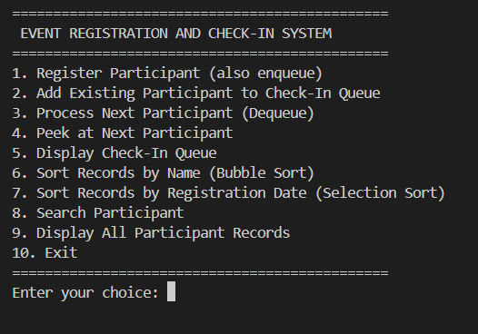
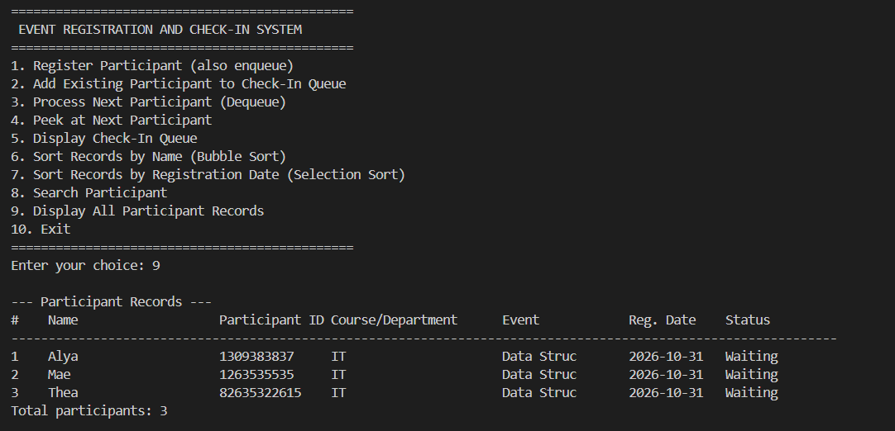
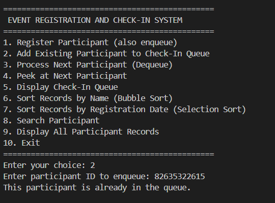
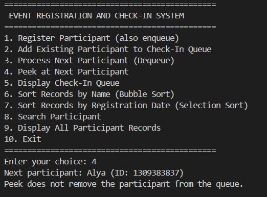
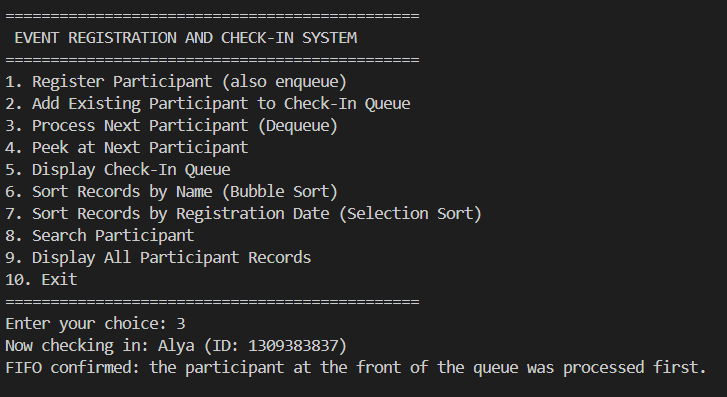
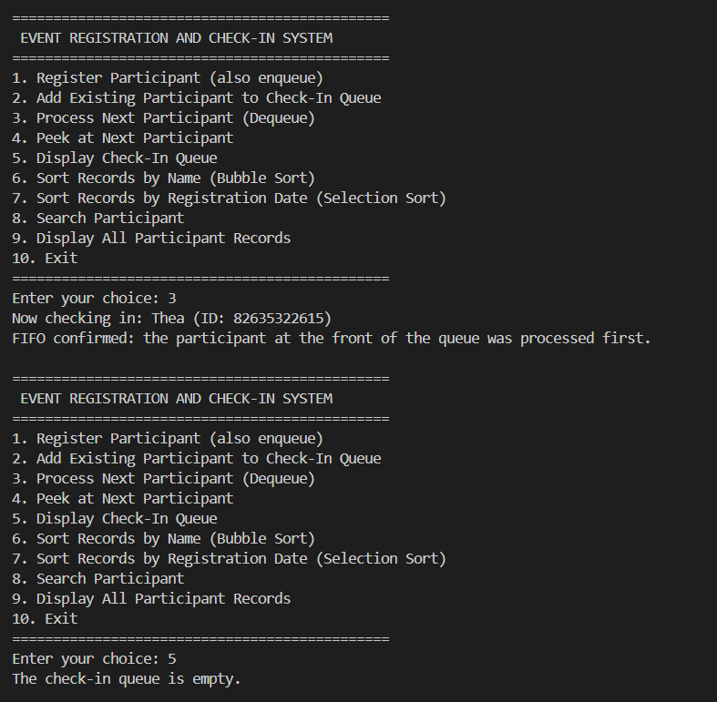
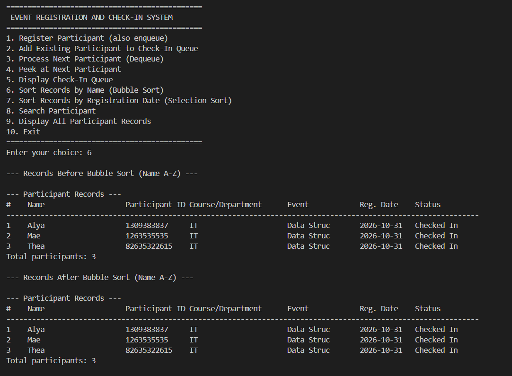
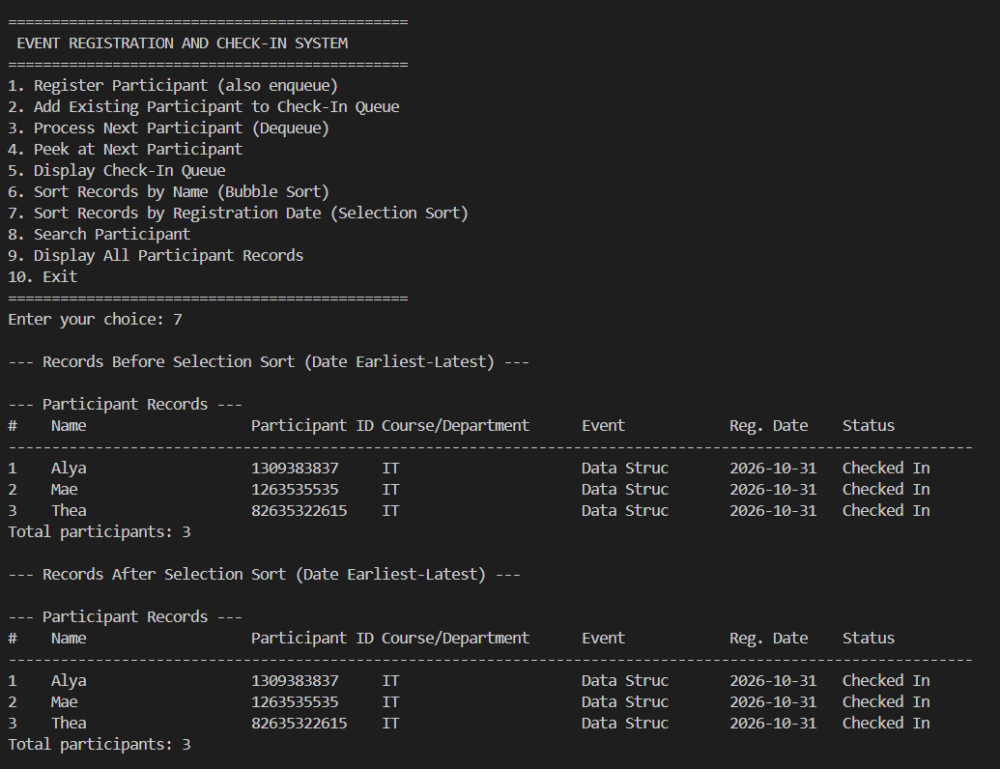
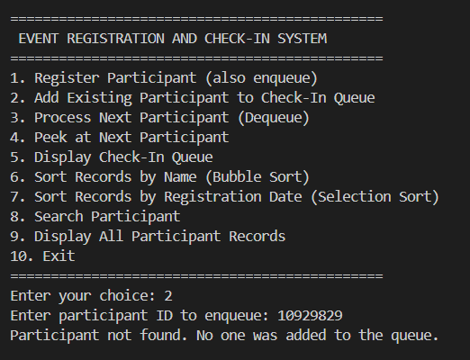

# Event Registration and Check-In System

## Project Description
This console-based Java application manages event participants and their check-in process. Participants are stored as records, placed in a FIFO queue, and processed in the order they joined the queue. The application also provides two manually implemented sorting algorithms.

## Objectives
- Register and store event participant information.
- Manage check-in using a First-In, First-Out (FIFO) queue.
- Search participant records by name or participant ID.
- Organize records using Bubble Sort and Selection Sort.
- Validate user input and display clear error messages.
- Use procedural programming and Java ArrayLists without custom entity classes.

## Features
1. Register a participant (the participant is automatically added to the queue).
2. Add an existing registered participant to the queue.
3. Process the next participant (dequeue/check in).
4. Peek at the next participant without removing them.
5. Display the queue from front to rear.
6. Sort records by name using Bubble Sort.
7. Sort records by registration date using Selection Sort.
8. Search by full/partial name or participant ID.
9. Display all participant records.
10. Exit the application.

## Data Structures
### ArrayLists
The program uses parallel `ArrayList<String>` collections for names, participant IDs, email addresses, contact numbers, courses/departments, event names/types, registration dates, and statuses. The same index in each list represents the same participant. The `swapRecords` method swaps all lists together during sorting to preserve data consistency.

### Queue
A `Queue<String>` backed by `LinkedList<String>` stores participant IDs. The queue is meaningful to check-in: `offer()` adds to the rear, `peek()` views the front without removing it, and `poll()` removes the front participant for processing. Because the queue stores IDs rather than list indexes, sorting participant records does not change the queue's FIFO order.

## Sorting Algorithms
### Bubble Sort — Sort by Name
Bubble Sort compares adjacent participant names and swaps complete records when they are out of alphabetical order. It is straightforward to demonstrate and is suitable for a small student project dataset.

### Selection Sort — Sort by Registration Date
Selection Sort finds the earliest remaining registration date and places that record in the next position. Dates are validated and stored in `YYYY-MM-DD` format, so chronological string comparison works correctly.

Both algorithms are implemented manually. The program does not use `Collections.sort()`, `Arrays.sort()`, or other built-in sorting methods.

## Procedural Programming Compliance
The program contains one required Java entry-point class (`Main`) and static methods. It does not define custom participant/entity classes, inheritance, polymorphism, or custom queue/sorting classes. Built-in Java classes are used only for input handling and collection support.

## How to Run
You need a JDK installed.

### From the project root
```bash
javac src/Main.java
java -cp src Main
```

### From the `src` folder
```bash
javac Main.java
java Main
```

## Screenshots

### Main menu
The main menu lists all ten options: registration, queue operations, two sorting algorithms, search, display records, and exit.


### Registering participants and displaying records
Option 1 registers a participant and adds them to the check-in queue. Option 9 then displays all stored records in a table.


### Queue operations
Enqueue adds a participant to the end of the queue, peek shows the front participant without removing them, and dequeue processes the front participant.




### FIFO behavior
The first participant added to the queue is the first one processed, and the queue is empty once everyone has been processed.


### Bubble Sort
Records shown before and after sorting by name (A-Z).


### Selection Sort
Records shown before and after sorting by registration date (earliest to latest).


### Input validation
Entering a participant ID that does not exist is rejected with the message "Participant not found. No one was added to the queue."


## Notes
- Records exist in memory only while the program is running; they are not saved to a file or database.
- Use a unique participant ID for every participant.
- Registration dates must use `YYYY-MM-DD`.
- Registering a participant automatically adds them to the check-in queue. The separate queue option is for adding an already registered participant who is not currently queued and has not checked in.
